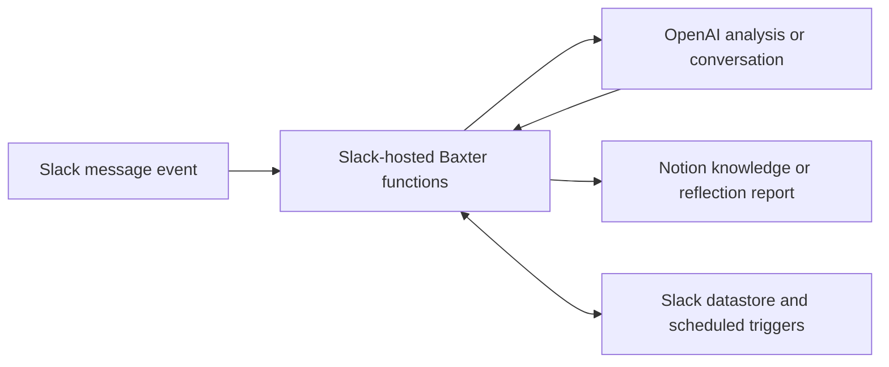

# Baxter: Slack-hosted workflows

Baxter is one custom Slack app supporting two separate workflows:

- **Weekly reflections:** Friday prompts, individual AI conversations, Monday
  collection and a Notion report.
- **Vendor perspectives:** new-message events, candidate matching, isolated AI
  extraction, duplicate checks and source-linked Notion captures.

The implementation is in [slack-hosted](slack-hosted/). The existing
[reflection operating guide](../Weekly%20Reflection%20%28Baxter%29/README.md)
describes the weekly experience.

## Where everything runs

GitHub stores source code and documentation. Slack runs the deployed app and
stores workflow state. OpenAI runs the configured analysis/conversation
sessions. Notion holds the resulting knowledge and reports. Pushing code here
does **not** automatically redeploy Baxter.

Vendor analysis is isolated: it has no tools, credential vaults or network
environment. Reflection conversation sessions separately use the configured
bot-only vault and a Slack-only hosted sandbox to respond inside their
authorized participant conversation.

Granola ingestion and the daily 9 a.m. Eastern Slack reconciliation are separate
Codex automation work, outside this Slack app. The daily reconciliation recovers
richer thread context and sources the live matcher may miss.

## Source and configuration

This is a sanitized source snapshot of the app deployed October 14, 2026,
including both workflows, the legacy restricted pilot and operational
verification helpers. Workspace, bot, user, channel, OpenAI project, vault and
Notion identifiers have been moved into an ignored deployment configuration.
Credentials, local Slack account files, transcripts and the one-off replay
containing a real Slack message are excluded.

The public source is a maintainable baseline, not a drop-in production
configuration. Retain the authorized private configuration and compare the
current Slack deployment before redeploying. The production app was not
redeployed as part of adding this source to GitHub.

## Verified snapshot

All 26 automated tests pass with example configuration. Full TypeScript
checking, formatting and lint pass. Tests mock external APIs; they do not send
messages or modify Notion. Production setup separately verified schema access,
temporary create/read/archive permissions and completion of a real-message
replay returning no new insights. An organic message-posted event and production
extraction write were not verified by that replay.

## Limits

The vendor listener processes eligible human messages from ordinary
public/private channels Baxter has joined. DMs, bot messages, message
edits/deletions and full-thread reconstruction are excluded. Slack Connect event
triggers are unsupported; use the daily fallback. New private channels require a
member to invite Baxter. Candidate matching and semantic deduplication are
best-effort; Notion provides no atomic uniqueness constraint across concurrent
writers.
